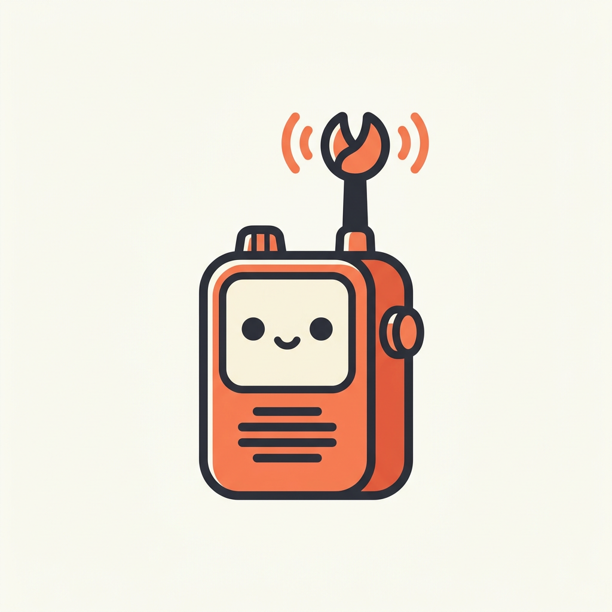

<p align="center"></p>

# Clawkie

A walkie-talkie for your Claude Code agents. Claude Code sessions on different machines (laptop, VM, servers) working on the same project pair up, see what each other is doing, and pass prompts and results back and forth, so you stop copy-pasting between terminals.

```
laptop (brave-otter)  ──"run the squid migration, report back"──▶  vm (rusty-falcon)
                      ◀──"done: 3 migrations applied, please verify"──
```

## Setup (each machine)

Needs Node 22+ and Claude Code logged in with claude.ai.

```bash
git clone https://github.com/dilukangelosl/clawkie && cd clawkie && npm i --omit=dev
claude mcp add -s user clawkie -- node "$PWD/clawkie.js"
```

Start sessions with the channel enabled, so incoming messages wake Claude up:

```bash
claude --dangerously-load-development-channels server:clawkie
```

(The flag is needed while Claude Code channels are in research preview and Clawkie isn't on the allowlist. Without it, everything still works, but Claude only sees messages when it calls `clawkie_inbox`.)

## Pairing

1. In session A: *"clawkie invite"* → shows e.g. `brave-otter · 482913` (valid 10 min, single use).
2. In session B: *"clawkie join brave-otter 482913"*.

They're now in one group. Pair more sessions the same way. *"clawkie leave"* unpairs.

## Modes

- **ask** (default): when a peer sends work, Claude shows you who sent it and what it is, and waits for your yes.
- **auto**: Claude acts right away (your normal tool permissions still apply). Set it per machine:
  `claude mcp add -s user -e CLAWKIE_MODE=auto clawkie -- node "$PWD/clawkie.js"`

The mode is an env var on purpose. No tool can change it, so a peer message can't talk a session into auto.

## Tools

`clawkie_whoami` · `clawkie_invite` · `clawkie_join` · `clawkie_send` · `clawkie_status` · `clawkie_peers` · `clawkie_inbox` · `clawkie_leave`

Built-in instructions tell every session to report back with `clawkie_send` when it finishes a peer's task, and to keep its `clawkie_status` line current.

## How it works

- `clawkie.js`: local MCP server per session. Gets a name (`adjective-animal`) on first run and stores it in `~/.clawkie/` per working directory (`CLAWKIE_ID` to override). Holds a WebSocket to the relay and pushes messages into Claude Code as channel events.
- `relay/`: Cloudflare Worker + one SQLite Durable Object. Stores sessions (token hashed), groups, invites, and undelivered messages until they're acked.

## Dev

```bash
npm run dev                                   # relay on :8787
CLAWKIE_URL=http://localhost:8787 npm test    # two real sessions pair + message end-to-end
npm run deploy
```
